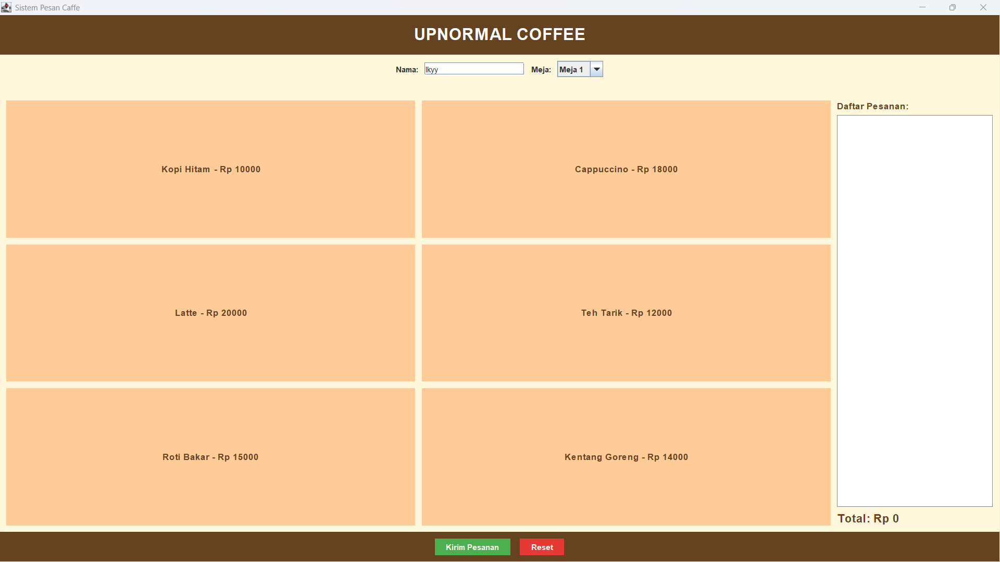
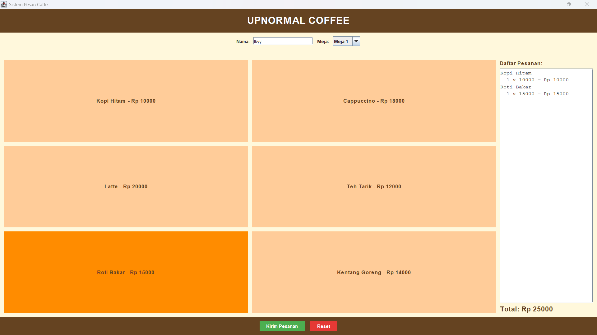
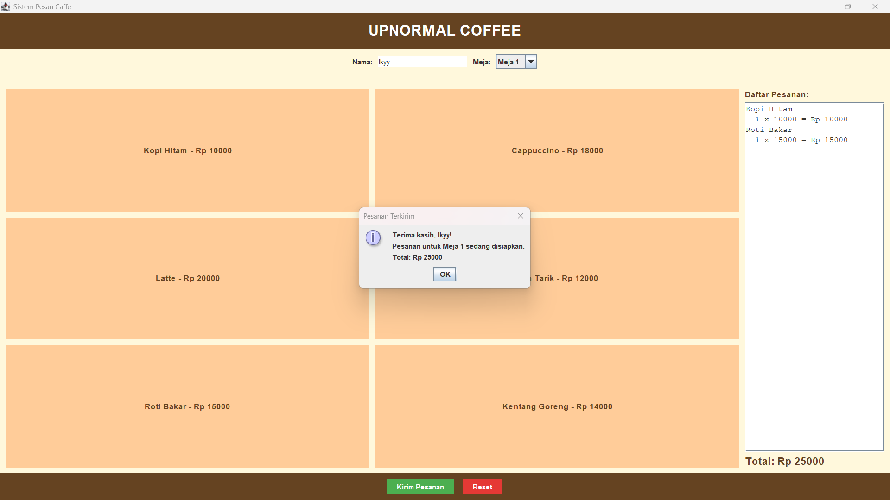

# Sistem Pesan Caffe (UPNORMAL COFFEE)

Aplikasi GUI Java Swing untuk memesan menu caffe. Pelanggan mengisi nama dan meja, klik menu yang diinginkan, lalu klik Kirim Pesanan. Daftar pesanan dan total harga muncul otomatis.

- **Nama: Muhammad Rizky Hisyam**
- **NIM: F1D02410018**

## Komponen yang Digunakan

**Top Level Container**
- `JFrame`: jendela utama aplikasi
- `JOptionPane`: dialog peringatan dan dialog pesanan terkirim

**Intermediate Container**
- `JPanel`: mengelompokkan komponen (header, data pelanggan, menu, pesanan, tombol)
- `JScrollPane`: membungkus area pesanan agar bisa di-scroll

**Atomic Component**
- `JLabel`: judul dan keterangan
- `JTextField`: input nama pelanggan
- `JComboBox`: pilihan nomor meja
- `JButton`: tombol menu, Kirim Pesanan, dan Reset
- `JTextArea`: menampilkan daftar pesanan

**Layout Manager**
- `BorderLayout`: kerangka utama (atas, tengah, kanan, bawah)
- `FlowLayout`: susunan berderet (header, data pelanggan, tombol bawah)
- `GridLayout`: susunan kotak (tombol menu 3x2)

**Event Handling (2 interface)**
- `ActionListener`: menangani klik tombol (tambah menu, kirim pesanan, reset)
- `MouseListener`: efek hover, warna tombol menu berubah saat kursor masuk (`mouseEntered`) dan kembali saat keluar (`mouseExited`)

## Screenshot

**1. Tampilan awal**
Belum ada pesanan, total Rp 0.

**2. Memilih menu dan efek hover**
Contoh: Kopi Hitam dan Roti Bakar dipilih. Tombol Roti Bakar berubah warna karena kursor berada di atasnya (`MouseListener`).

**3. Dialog pesanan terkirim**
Muncul setelah klik Kirim Pesanan (`JOptionPane`).

**4. Setelah pesanan dikirim**
Form otomatis kosong kembali untuk pelanggan berikutnya.

